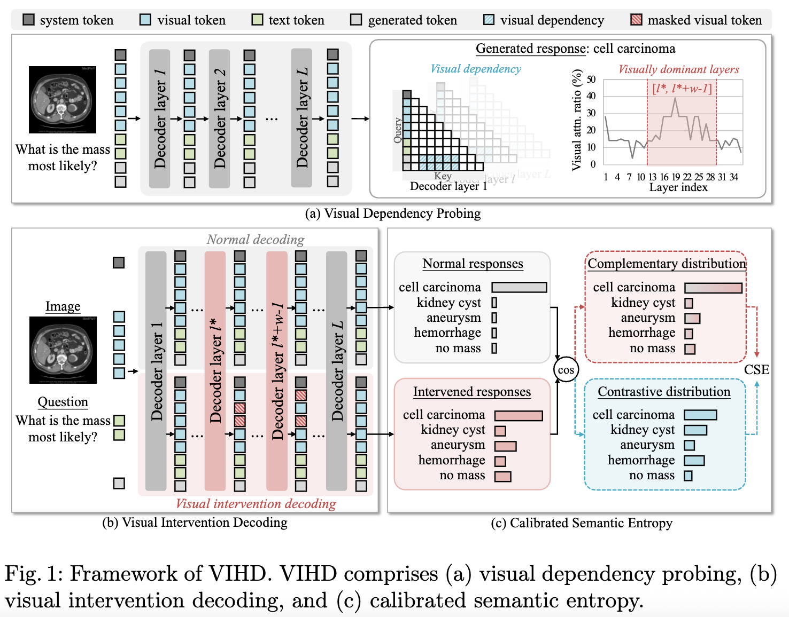
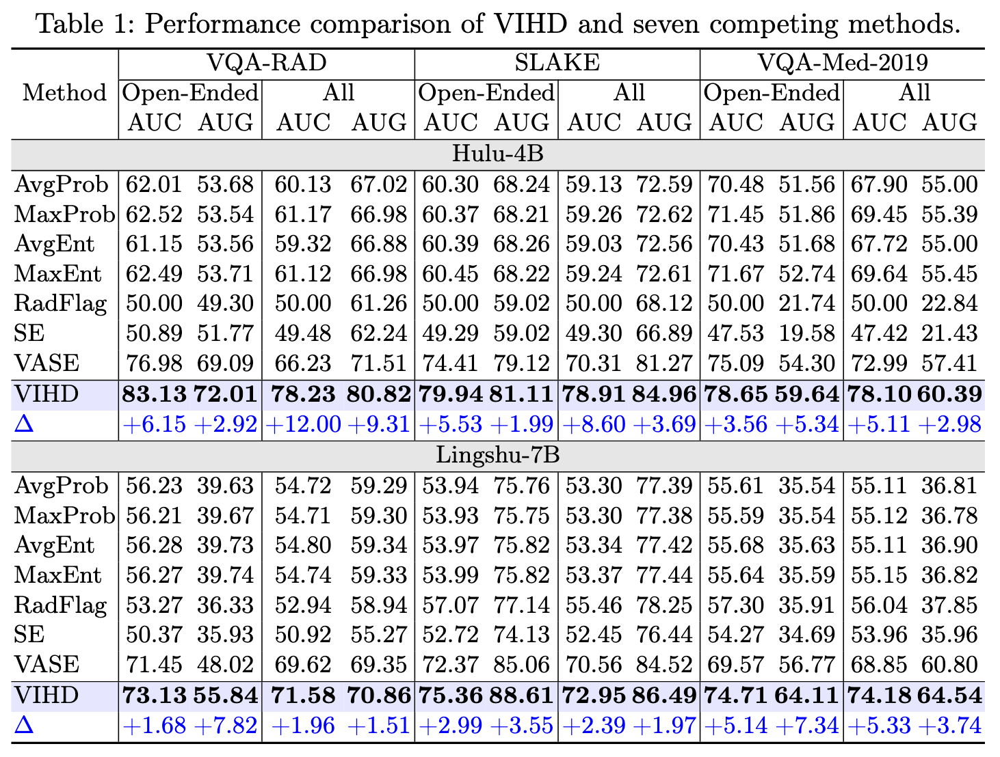

# [MICCAI26] VIHD 

This is the official implementation of the MICCAI 2026 paper "VIHD: Visual Intervention-based Hallucination Detection for Medical Visual Question Answering" **(Oral)**.

<p align="center">
  
</p>


## 💻 Requirements
This project requires two separate conda environments: `env_hallu` for hallucination detection and `env_green` for GREEN-based evaluation. They can be created from the provided environment files as follows:

```bash
# Hallucination Detection (env_hallu)
conda env create -f hallu_environment.yml    

# GREEN Evaluation
conda env create -f green_environment.yml    
```

## 🚀 Usage

### Hallucination Detection
```bash
conda activate env_hallu

python main_hall_det_VIHD.py \
  --dataset vqa-rad \
  --model hulu \
  --type close \
  --mode test
```

| Argument | Options | Default | Description |
|---|---|---|---|
| `--dataset` | `vqa-rad`, `slake`, `vqa-med-2019` | `vqa-rad` | Medical VQA dataset |
| `--model` | `lingshu`, `hulu` | `lingshu` | Backbone MLLM |
| `--type` | `open`, `close` | `open` | Question type |
| `--mode` | `test` | `test` | Dataset split |
| `--augment` | flag | off | Apply image augmentation to the sampled inputs |
| `--num_samples` | int | `10` | Number of sampled responses per branch |
| `--seed` | int | `815` | Random seed |

Results are saved to `det_outputs_{mode}/{dataset}_{model}_vihd_{type}.csv`. With `--augment` on, the file name ends in `_aug`.

### GREEN Evaluation

Evaluate the generated answers with GREEN, then evaluate the hallucination detection performance:

```bash
conda activate env_green

torchrun --nproc_per_node=1 det_green_eval.py \
  --dataset vqa-rad \
  --model hulu \
  --type close

python hall_det_eval.py \
  --dataset vqa-rad \
  --model hulu \
  --type close
```

Use the same `--dataset`, `--model` and `--type` as in Hallucination Detection.

## Results

<p align="center">
  
</p>


## Citation

```bibtex
@inproceedings{chen2026vihd,
  title={VIHD: Visual Intervention-based Hallucination Detection for Medical Visual Question Answering},
  author={Chen, Jiayi and Ma, Benteng and Liao, Zehui and Chong, Winston and George, Yasmeen and Cai, Jianfei},
  booktitle={International Conference on Medical Image Computing and Computer-Assisted Intervention},
  pages={643--653},
  year={2026},
  organization={Springer}
}
```